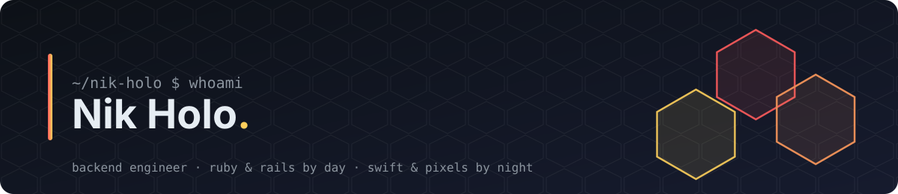

  

  

  
  
  

 

## 👋 About me

- 🏦 Backend engineer working on a **CRM for digital mortgage financing** — Rails monolith, Kafka, a lot of PostgreSQL.
- 🤖 Currently building an **MCP server + LLM chat layer** so advisors can talk to the CRM in plain language.
- 🍎 Evenings go to **native macOS apps in Swift** — tiny tools that fix one annoyance each.
- 🎮 Occasionally I ship a browser game instead of sleeping.
- 🇺🇦 Ukrainian, based in the EU 🇪🇺. I also maintain a set of Ukrainian keyboard layouts for Mac.
- 📝 I keep an Obsidian vault for everything and probably over-document.

## 🧰 Toolbox

  
  
  
  
  
  
  
  
  
  
  
  
  
  
  
  
  

## 🚀 Things I made

<table>
  <tr>
    <td width="50%" valign="top">
      <h3><a href="https://github.com/nik-holo/kuroko">🥷 kuroko</a></h3>
      
macOS menu bar app that silently converts downloaded WebP / AVIF / HEIC images into JPEG / PNG / GIF. Zero dependencies, pure ImageIO. Named after the black-clad kabuki stagehand you agree not to see.

        
    </td>
    <td width="50%" valign="top">
      <h3><a href="https://github.com/nik-holo/battle_hex">⬢ Battle Hex</a></h3>
      
Turn-based hex tactics in the browser. Draft 5 of 20 units, spend 10 AP per turn, fight over special hexes against a greedy AI. Runs on Cloudflare Workers.

        
    </td>
  </tr>
  <tr>
    <td width="50%" valign="top">
      <h3><a href="https://github.com/nik-holo/montexia-theme">🎨 Montexia</a></h3>
      
Dark VS Code theme (works in Cursor / Windsurf / Antigravity too), somewhere between Monokai and One Dark Pro with a hand-tuned palette.

      
    </td>
    <td width="50%" valign="top">
      <h3><a href="https://github.com/nik-holo/typography-layout-ua">⌨️ typography-layout-ua</a></h3>
      
Typographer's keyboard layouts for Ukrainian Mac users: proper quotes, dashes, apostrophes and the rest, without hunting through the character viewer.

       
    </td>
  </tr>
</table>

  
🗄️ Older Ruby bits

   
  <ul>
    <li><a href="https://github.com/nik-holo/servus">servus</a> — a tiny gem for service objects.</li>
    <li><a href="https://github.com/nik-holo/encrypted_cookie">encrypted_cookie</a> — AES-128 encrypted session cookies for Rack / Sinatra.</li>
    <li><a href="https://github.com/nik-holo/has_states">has_states</a> — minimal state handling for ActiveRecord.</li>
  </ul>

## 📊 Stats

  
  

  

  

## 📫 Say hi

  
  

  

